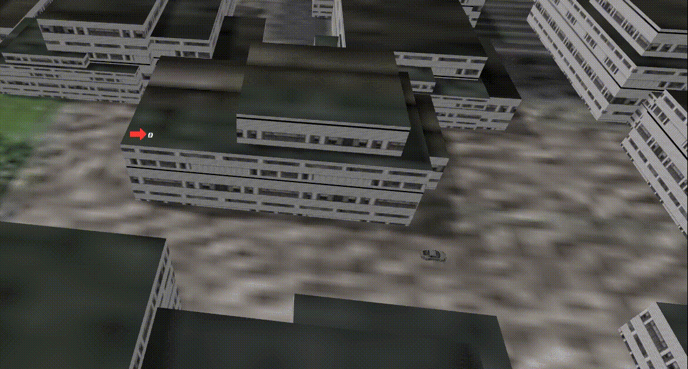
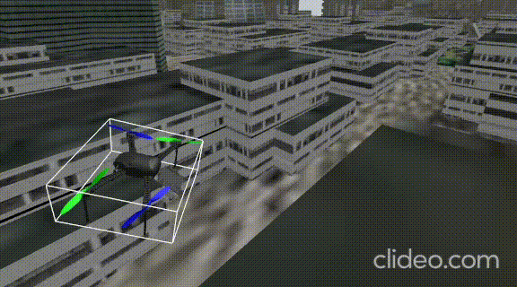
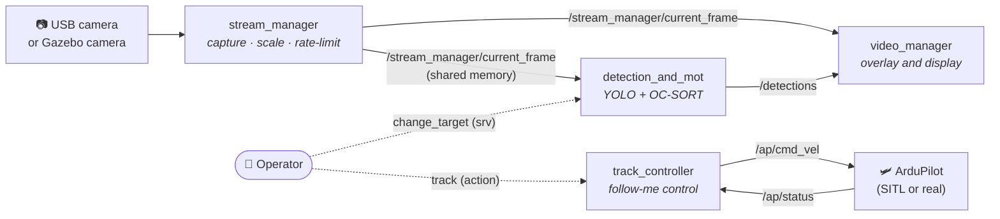

<div align="center">

# 🚁 TrackingDrone

**Real-time object detection, multi-object tracking and target following for drones, built on ROS 2.**

YOLO detection · OC-SORT tracking · zero-copy video pipeline · ArduPilot + Gazebo simulation

[](https://docs.ros.org/en/humble/)
[](#)
[](https://github.com/microsoft/onnxruntime)
[](https://opencv.org/)
[](https://ardupilot.org/)
[](https://gazebosim.org/)
[](https://www.gnu.org/licenses/agpl-3.0)

<table>
  <tr>
    <td align="center"></td>
    <td align="center"></td>
  </tr>
  <tr>
    <td align="center"><b>Following a moving car</b></td>
    <td align="center"><b>Hovering in wind</b></td>
  </tr>
</table>

[Quick start](#-quick-start) ·
[Architecture](#-architecture) ·
[Simulation](simulation/README.md) ·
[Configuration](#%EF%B8%8F-configuration) ·
[Roadmap](#%EF%B8%8F-roadmap)

</div>

---

## ✨ Overview

TrackingDrone is a modular ROS 2 stack that lets a drone **see, track and follow** a target. Video comes in from a real camera or a Gazebo simulation, a YOLO model finds objects, OC-SORT gives each one a stable ID across frames, and a controller sends velocity commands to ArduPilot to keep the chosen target in view.

Every stage is a separate ROS 2 package, so you can reuse the detector on its own, swap in your own model, or run the whole pipeline on recorded video without a drone.

## 🚀 Features

- **Real-time detection**: any YOLO model exported to ONNX, run with ONNX Runtime on CPU or GPU.
- **Multi-object tracking**: OC-SORT keeps a persistent ID for each object, even through short occlusions.
- **Target selection at runtime**: switch the tracked target with a ROS 2 service call.
- **Zero-copy frames**: video moves between nodes over shared memory ([ros2_shm_msgs](https://github.com/ZhenshengLee/ros2_shm_msgs)) to keep latency low.
- **Latency-aware timing**: detections are time-stamped against the frame they came from, and the viewer overlays them on the matching cached frame.
- **Sim and real with one switch**: the same launch file reads from Gazebo or a USB camera.
- **Follow-me control**: a ROS 2 action server flies the drone at a requested altitude and distance from the target through ArduPilot DDS.
- **Full simulation**: ArduPilot SITL, Gazebo and an OpenStreetMap world with a moving car to test against.

## 🧩 Architecture



### Packages

| Package | Language | What it does |
| --- | --- | --- |
| [`stream_manager`](https://github.com/ahmedmsalah99/StreamManager) | C++ | Reads frames from a USB camera or Gazebo, scales them and publishes them at a fixed rate over shared memory. *(submodule)* |
| [`detection_and_mot`](src/detection_and_mot) | C++ | Runs YOLO (ONNX Runtime) and OC-SORT, then publishes tracked detections. |
| [`video_manager`](src/video_manager) | C++ | Shows the video with boxes, IDs and the current target drawn on it. |
| [`track_controller`](src/track_controller) | C++ | `Track` action server that sends velocity commands to ArduPilot to follow the target. |
| [`common_msgs`](src/common_msgs) | IDL | Shared `Detection`/`Detections` messages, `ChangeTarget` service and `Track` action. |
| [`detect_and_track_bringup`](src/detect_and_track_bringup) | Python | Launch file and YAML configs that start the perception pipeline. |
| [`moc_video_publisher`](src/moc_video_publisher) | Python | Publishes a video file as a camera topic, for testing without a camera or simulator. |
| [`ros2_shm_msgs`](https://github.com/ZhenshengLee/ros2_shm_msgs) | C++ | Shared-memory image messages. *(submodule)* |
| [`R-VIO`](https://github.com/ahmedmsalah99/R-VIO) | C++ | Visual-inertial odometry, being integrated. *(submodule)* |

## ⚡ Quick start

### Prerequisites

| Requirement | Tested version |
| --- | --- |
| Ubuntu | 22.04 |
| [ROS 2](https://docs.ros.org/en/humble/Installation.html) | Humble |
| [ONNX Runtime](https://github.com/microsoft/onnxruntime/releases) | 1.20.1 |
| OpenCV | 4.5.5 |
| Eigen3, yaml-cpp | system packages |

### 1. Clone with submodules

```bash
git clone --recursive https://github.com/ahmedmsalah99/TrackingDrone.git
cd TrackingDrone
```

If you already cloned without `--recursive`:

```bash
git submodule update --init --recursive
```

### 2. Get the model and ONNX Runtime

1. Download the model and test resources from the [**OneDrive folder**](https://1drv.ms/f/c/ba4a36e37e136c1e/Espk4TyxO-hJscBR4_XtCf4BybTYcVzWY7BKRy2OZeNyQw?e=z4Fg1S) and put the `.onnx` model and its labels in `src/detection_and_mot/resources/`.
2. Download the [ONNX Runtime release](https://github.com/microsoft/onnxruntime/releases) for your platform, rename the extracted folder to `onnxruntime` and place it at `src/detection_and_mot/onnxruntime/`.

> [!TIP]
> Exporting your own model to ONNX on the target device often gives better speed than the provided model. Set its file name in [`detection_and_mot_params.yaml`](src/detect_and_track_bringup/config/detection_and_mot_params.yaml).

> [!NOTE]
> OC-SORT ships prebuilt in `src/detection_and_mot/lib/`. To build it yourself, use the modified fork: [ahmedmsalah99/OC_SORT](https://github.com/ahmedmsalah99/OC_SORT).

### 3. Build

From the repository root (it is the colcon workspace):

```bash
source /opt/ros/humble/setup.bash
colcon build
```

### 4. Set up the environment

Enable Fast DDS shared-memory transport so frames are passed without copies:

```bash
source install/setup.bash
export RMW_IMPLEMENTATION=rmw_fastrtps_cpp
export FASTRTPS_DEFAULT_PROFILES_FILE=$(pwd)/src/ros2_shm_msgs/config/shm_fastdds.xml
export RMW_FASTRTPS_USE_QOS_FROM_XML=1
```

### 5. Launch

```bash
# Gazebo camera (default)
ros2 launch detect_and_track_bringup bringup.launch.py mode:=sim

# USB camera
ros2 launch detect_and_track_bringup bringup.launch.py mode:=real
```

A window opens with live detections and their track IDs.

### 6. Fly it in simulation

To fly a drone in ArduPilot SITL + Gazebo and have it follow a car, follow the **[simulation guide](simulation/README.md)**. Once the drone is airborne in guided mode:

```bash
ros2 run track_controller track_controller
ros2 action send_goal --feedback track common_msgs/action/Track "{required_alt: 25.0, required_dist: 10.0}"
```

## 📡 ROS 2 interfaces

| Name | Type | Direction | Description |
| --- | --- | --- | --- |
| `/stream_manager/current_frame` | `shm_msgs/msg/Image1m` | topic | Latest frame, scaled and rate-limited |
| `/detections` | `common_msgs/msg/Detections` | topic | Tracked boxes (`x, y, width, height, id, conf, class_id`) and the current target ID |
| `/change_target` | `common_msgs/srv/ChangeTarget` | service | Move the target selection (`vertical`, `horizontal`) to a neighbouring object |
| `/track` | `common_msgs/action/Track` | action | Follow the target at `required_alt` / `required_dist`; result is `canceled`, `aborted` or `lost` |
| `/ap/cmd_vel` | `geometry_msgs/msg/TwistStamped` | topic | Velocity commands sent to ArduPilot |

## ⚙️ Configuration

All settings live in [`src/detect_and_track_bringup/config/`](src/detect_and_track_bringup/config). Rebuild or use `colcon build --symlink-install` after editing.

| File | Parameter | Default | Meaning |
| --- | --- | --- | --- |
| `detection_and_mot_params.yaml` | `model_path` | `best3_nano.onnx` | ONNX model in `detection_and_mot/resources/` |
| | `labels_path` | `coco_mod.names` | Class names file |
| | `use_gpu` | `false` | Run inference on the GPU (CUDA build of ONNX Runtime) |
| | `detection_fps` | `10.0` | How often detection runs. Keep it at or below your model's worst-case FPS |
| | `delay_time` | `0.25` | Assumed detection + tracking latency (s). Used to time-stamp results and drop stale detections |
| `stream_manager_{sim,real}_params.yaml` | `video_source.type` | `gazebo_ros2` / `usb_camera` | Frame source |
| | `buffer.target_fps` | `30.0` | Maximum publish rate. Keep it below the source FPS |
| | `scaling.target_width/height` | `640×480` | Resize frames before publishing |
| `video_manager_params.yaml` | `num_frames_cached` | `50` | Frames kept so detections can be drawn on the frame they belong to |
| | `detection_time_out` | `0.7` | Seconds without detections before showing the plain live feed |

Per-package notes: [detection_and_mot](src/detection_and_mot/README.md) · [video_manager](src/video_manager/README.md) · [stream_manager](https://github.com/ahmedmsalah99/StreamManager#readme)

## 📁 Project structure

```text
TrackingDrone/
├── src/
│   ├── common_msgs/               # messages, service, action
│   ├── detect_and_track_bringup/  # launch + YAML configs
│   ├── detection_and_mot/         # YOLO + OC-SORT node
│   ├── moc_video_publisher/       # video file → camera topic
│   ├── track_controller/          # follow-me action server
│   ├── video_manager/             # visualisation
│   ├── stream_manager/            # submodule
│   ├── ros2_shm_msgs/             # submodule
│   └── R-VIO/                     # submodule
└── simulation/
    ├── README.md                  # ArduPilot + Gazebo setup guide
    ├── ros2_gz.repos              # vcs file for the simulation stack
    ├── osm_environment/           # OpenStreetMap Gazebo world
    └── resources/                 # demo GIFs
```

## 🗺️ Roadmap

- [x] Object detection and multi-object tracking
- [x] ArduPilot SITL + Gazebo simulation
- [ ] Follow-me control *(working with ground-truth target pose; vision-based next)*
- [ ] Visual-inertial odometry with R-VIO *(integration in progress)*
- [ ] Vehicle tracking from onboard detections
- [ ] Vehicle position estimation

## 🤝 Contributing

Issues and pull requests are welcome. For larger changes, please open an issue first to discuss the idea.

## 📄 License

Released under the [GNU AGPL v3](https://www.gnu.org/licenses/agpl-3.0) license.

## 🙏 Acknowledgments

- [YOLOs-CPP](https://github.com/Geekgineer/YOLOs-CPP): YOLO inference in C++
- [OC-SORT](https://github.com/noahcao/OC_SORT): observation-centric multi-object tracking
- [ros2_shm_msgs](https://github.com/ZhenshengLee/ros2_shm_msgs): shared-memory ROS 2 messages
- [ArduPilot](https://ardupilot.org/) and [ardupilot_gz](https://github.com/ArduPilot/ardupilot_gz): flight stack and Gazebo integration
- [R-VIO](https://github.com/rpng/R-VIO): robocentric visual-inertial odometry

<div align="center">

⭐ If this project helps you, consider giving it a star!

</div>
