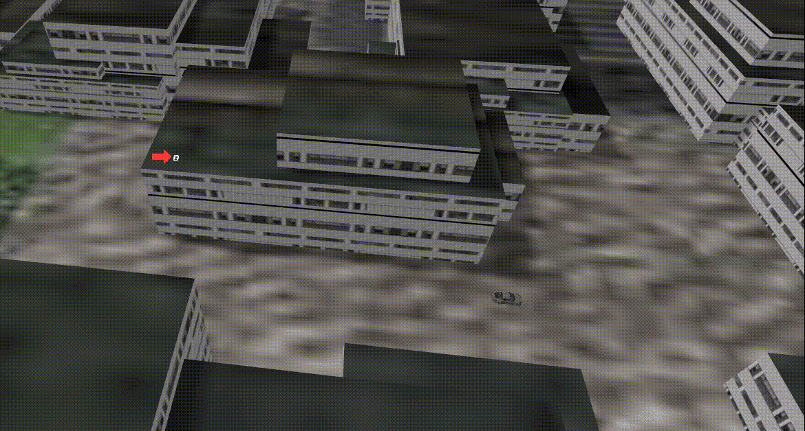
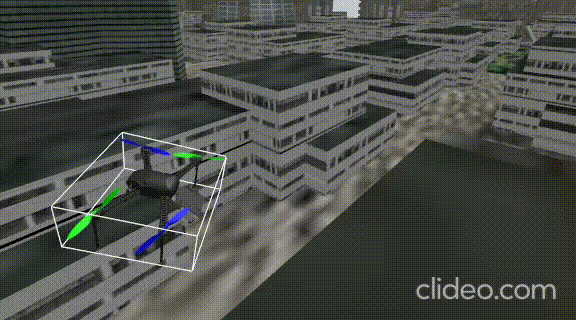

<div align="center">

# 🛩️ TrackingDrone Simulation

**ArduPilot SITL + Gazebo + ROS 2 Humble, with an OpenStreetMap world and a moving car to follow.**

<table>
  <tr>
    <td align="center"></td>
    <td align="center"></td>
  </tr>
  <tr>
    <td align="center"><b>Car tracking</b></td>
    <td align="center"><b>Hovering in wind</b></td>
  </tr>
</table>

[← Back to main README](../README.md)

</div>

## Contents

- [Setup](#setup)
  - [1. Import the simulation repositories](#1-import-the-simulation-repositories)
  - [2. Install dependencies](#2-install-dependencies)
  - [3. Build Micro-XRCE-DDS-Gen](#3-build-micro-xrce-dds-gen)
  - [4. Build the workspace](#4-build-the-workspace)
  - [5. Add the Gazebo world](#5-add-the-gazebo-world)
- [Running](#running)
  - [Waypoint mission](#waypoint-mission)
  - [Follow a car](#follow-a-car)
- [Troubleshooting](#troubleshooting)
- [References](#references)

## Setup

The setup is based on [ArduPilot/ardupilot_gz](https://github.com/ArduPilot/ardupilot_gz). The same steps (and the same issues) apply if you only need Gazebo + ArduPilot without ROS 2.

### 1. Import the simulation repositories

This step takes a while.

```bash
cd ws/src
vcs import --recursive < ros2_gz.repos
cd ..
```

### 2. Install dependencies

```bash
export ROS_VERSION=2
export ROS_PYTHON_VERSION=3
export ROS_DISTRO=humble
```

```bash
source /opt/ros/${ROS_DISTRO}/setup.bash
sudo apt update
rosdep update
rosdep install --rosdistro ${ROS_DISTRO} --from-paths src --ignore-src -y
```

### 3. Build Micro-XRCE-DDS-Gen

ArduPilot needs its own fork of Micro-XRCE-DDS-Gen (see [ArduPilot PR #29850](https://github.com/ArduPilot/ardupilot/pull/29850/files)).

> [!TIP]
> Gradle 7.6 and Java 17 are known to work. This is not strict, so try without changing versions first and come back here if the build fails.
>
> ```bash
> gradle -v
> java -version
> ```
>
> Install Java 17, or switch between installed versions:
>
> ```bash
> sudo apt install openjdk-17-jdk -y
> sudo update-alternatives --config java
> ```

```bash
git clone --recurse-submodules --branch v4.7.0 https://github.com/ardupilot/Micro-XRCE-DDS-Gen.git
cd Micro-XRCE-DDS-Gen
./gradlew assemble
export PATH=$PATH:$(pwd)/scripts
```

### 4. Build the workspace

> [!IMPORTANT]
> Read [Troubleshooting → Duplicate Fast DDS installs](#duplicate-fast-dds-installs) first: depending on your machine you may need that fix before building.

In the **same terminal** (so `Micro-XRCE-DDS-Gen` is on your `PATH`), from the `ws` folder:

```bash
colcon build --symlink-install --packages-skip ardupilot_dds_tests --cmake-args -DBUILD_TESTING=OFF -DCMAKE_BUILD_TYPE=RelWithDebInfo -DUAGENT_USE_SYSTEM_FASTDDS=OFF -DUAGENT_USE_SYSTEM_FASTCDR=OFF -DUAGENT_USE_SYSTEM_LOGGER=ON -DCMAKE_PREFIX_PATH=/opt/ros/humble --event-handlers console_cohesion+ desktop_notification-
```

If the build fails, see [Troubleshooting](#troubleshooting).

### 5. Add the Gazebo world

Download the `osm_environment` folder from [**OneDrive**](https://1drv.ms/f/c/ba4a36e37e136c1e/Elg7LCq3lyVAlq7tJH8TJ98BAybyg3v5VP2ceN41ZzSV-A?e=1YZqYd) and place it in one of your Gazebo resource folders:

```bash
echo $GZ_SIM_RESOURCE_PATH
```

Then source the simulation workspace:

```bash
source ./src/ardu_gz_ws/install/setup.bash
```

## Running

Start the simulation:

```bash
ros2 launch ardupilot_gz_bringup run_with_ns.launch.py ns:=/uav1
```

Start MAVProxy in a second terminal:

```bash
mavproxy.py --master=udp:127.0.0.1:14550 --out=udp:127.0.0.1:14553 --console --map
```

### Waypoint mission

In the MAVProxy terminal:

```bash
wp load ./src/ardupilot/Tools/autotest/Generic_Missions/CMAC-circuit.txt
mode auto
arm throttle
```

### Follow a car

1. Build the controller from the TrackingDrone workspace root. Also source the simulation workspace, since `track_controller` depends on `ardupilot_msgs`.

   ```bash
   colcon build --packages-select track_controller common_msgs
   source install/setup.bash
   ```

2. Take off from the MAVProxy terminal. Check the console that each command is accepted; the simulation may need some time to settle before it will arm.

   ```bash
   mode guided
   arm throttle
   takeoff 10
   ```

3. Start the controller:

   ```bash
   ros2 run track_controller track_controller
   ```

4. In another terminal, send a tracking goal:

   ```bash
   ros2 action send_goal --feedback track common_msgs/action/Track "{required_alt: 25.0, required_dist: 10.0}"
   ```

For more on ArduPilot with ROS 2, see the [ArduPilot ROS 2 SITL docs](https://ardupilot.org/dev/docs/ros2-sitl.html).

## Troubleshooting

<a name="duplicate-fast-dds-installs"></a>
<details>
<summary><b>Duplicate Fast DDS installs</b>: <code>Target already defined</code> (eProsima), or everything builds but no <code>/ap</code> topics in <code>ros2 topic list</code></summary>

You have more than one copy of Fast RTPS / Fast CDR / Fast DDS on your machine.

1. Look for copies under `/usr/local`. This should print nothing:

   ```bash
   sudo find /usr/local -iname "*fastdds*" -o -iname "*fastrtps*" -o -iname "*fastcdr*"
   ```

2. Remove each one (fast-rtps, fast-dds, fast-cdr, agent):

   ```bash
   sudo rm -rf /usr/local/include/fastrtps \
               /usr/local/include/fastdds \
               /usr/local/include/fastcdr \
               /usr/local/lib/libfastrtps* \
               /usr/local/lib/libfastdds* \
               /usr/local/lib/libfastcdr* \
               /usr/local/share/fastrtps* \
               /usr/local/share/fastdds* \
               /usr/local/share/fastcdr* \
               /usr/local/fastdds* \
               /usr/local/lib/cmake/fastcdr \
               /usr/local/include/uxr/agent
   ```

3. Run the `find` command again. If it still prints anything, there are traces left.

4. Build the libraries yourself (quick and smooth):

   ```bash
   git clone -b v1.1.0 https://github.com/eProsima/Fast-CDR.git
   cd Fast-CDR
   mkdir build && cd build
   cmake ..
   make -j$(nproc)
   sudo make install
   ```

   ```bash
   git clone -b v2.14.1 https://github.com/eProsima/Fast-DDS.git
   cd Fast-DDS
   mkdir build && cd build
   cmake ..
   make -j$(nproc)
   sudo make install
   ```

5. Build the Micro XRCE-DDS Agent from source against the installed Fast DDS and Fast CDR:

   ```bash
   git clone -b v2.4.2 https://github.com/eProsima/Micro-XRCE-DDS-Agent.git
   cd Micro-XRCE-DDS-Agent
   mkdir build && cd build
   cmake .. -DUAGENT_USE_SYSTEM_FASTDDS=ON -DUAGENT_USE_SYSTEM_FASTCDR=ON -DUAGENT_USE_SYSTEM_LOGGER=ON
   make -j$(nproc)
   sudo make install
   sudo ldconfig
   ```

</details>

<details>
<summary><b><code>.idl</code> error 255</b>, <code>-pre-allocate... not recognized</code> or <code>Status not recognized</code></summary>

You are using the wrong Micro-XRCE-DDS-Gen. Build the ArduPilot fork as in [step 3](#3-build-micro-xrce-dds-gen) and make sure its `scripts` folder is on your `PATH`.

</details>

<details>
<summary><b><code>did you mean serialize_array?</code></b></summary>

A copy of Fast DDS, Fast CDR or Fast RTPS is still installed. Follow [Duplicate Fast DDS installs](#duplicate-fast-dds-installs).

</details>

<details>
<summary><b><code>spdlog</code> errors</b></summary>

The error comes from the Micro XRCE-DDS Agent build. Clone, build and install the agent as in [Duplicate Fast DDS installs](#duplicate-fast-dds-installs), step 5, with `-DUAGENT_USE_SYSTEM_LOGGER=ON`. You can pass the same flag to the `colcon build` command.

</details>

<details>
<summary><b><code>AP DDS no ping response, exiting</code></b></summary>

1. Look for a dead agent process. If it died, delete the Micro XRCE-DDS Agent `build` and `install` folders and rebuild it with:

   ```bash
   --cmake-args -DUAGENT_USE_SYSTEM_LOGGER=ON
   ```

2. Run `ps aux | grep ros2` and make sure the processes are using Fast RTPS.
3. Make sure your `~/.bashrc` exports `RMW_IMPLEMENTATION=rmw_fastrtps_cpp`.

</details>

## References

- [ArduPilot/ardupilot_gz](https://github.com/ArduPilot/ardupilot_gz): the setup this guide is based on
- [ArduPilot ROS 2 SITL docs](https://ardupilot.org/dev/docs/ros2-sitl.html)
- [ArduPilot Micro-XRCE-DDS-Gen releases](https://github.com/ArduPilot/Micro-XRCE-DDS-Gen/releases)
- [PR #29850](https://github.com/ArduPilot/ardupilot/pull/29850): when the `Status` namespace was added
- [PR #26095](https://github.com/ArduPilot/ardupilot/pull/26095/files#diff-b6bb5deb44805458609561e9091f1045b31bd4d341ae4bea0531062628e7dfae): the PR that added the `-pre-allocate` argument
- [Wrong argument issue](https://discuss.ardupilot.org/t/compiling-arducopter-4-5-0-with-enable-dds-failed/115632/4) (ArduPilot forum)
- [`fs_radio` was not declared in this scope](https://discuss.ardupilot.org/t/dds-sitl-fs-radio-was-not-declared-in-this-scope-did-you-mean-flt-radix/134537) (ArduPilot forum)
